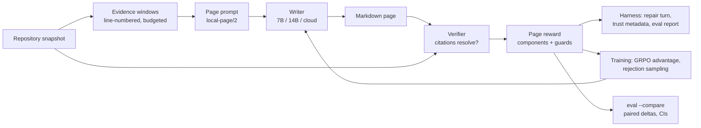

# The reward loop: measuring and improving the writer from both sides

This document explains, from first principles, the evaluation loop that now connects the
SemanticWiki CLI to model training. It is written so that someone who has never trained a
model can follow why each piece exists, and so that someone who has can see exactly what is
rewarded and what is not.

Status (November 2026): the loop is implemented and tested end to end with fake writers.
No model has been trained with it yet. Section 7 lists the experiments in order, and
section 8 is honest about what the numbers in this document do and do not establish.

## 1. The loop in one picture

Three programs consume the same two artifacts:

- `src/local-page.ts` and `research/semanticwiki_reward/evidence.py` build the **same prompt**
  from the same evidence windows (fixture: `tests/fixtures/prompt-conformance.json`).
- `src/eval` and `research/semanticwiki_reward/reward.py` compute the **same reward**
  (fixture: `tests/fixtures/reward-conformance.json`).

So a number produced by `semanticwiki eval` on a generated wiki, by `eval_runner.py` on a
held-out set, and by the reward function inside GRPO training all mean the same thing.
That is the property that lets us dead-reckon: change one thing, re-measure on a fixed set,
read the paired delta, keep or revert.

## 2. Where the project stood, with evidence

Before this change the harness and the model disagreed about the task.

**The model side.** The v3 work (`GhostScientist/semanticwiki-data-v3`,
`semanticwiki-eval-v3`) is the best-measured artifact in the lineage. It trained on 313
pages from 97 real repositories where every `path:start-end` citation was deterministically
verified, and it evaluated on 50 held-out repositories with paired statistics. Its headline
numbers (100 pages per arm):

| Arm | Citation validity | Fidelity (judge, 1-5) | Citations per page |
| --- | ---: | ---: | ---: |
| Qwen2.5-Coder-14B base | 0.315 | 3.17 | 3.4 |
| semanticwiki-coder-14b-v3 (SFT) | 0.694 | 3.51 | 7.0 |
| Qwen3-14B base | 0.707 | 4.11 | 7.0 |
| semanticwiki-14b-v3-qwen3 (SFT) | 0.417 | 3.29 | 3.9 |

The same supervised fine-tuning recipe raised validity by +0.38 on one base and lowered it
by -0.29 on the other, with every confidence interval excluding zero. That is the single most
important fact in this project: **SFT does not add a skill, it replaces a policy.** When the
base already cites well, replacing its policy with a 313-example imitation makes it worse.

**The shipped side.** The CLI defaults to `semanticwiki-coder-7b-v2`, trained on 28
examples in an older format. It was never evaluated under the v3 protocol.

**The harness side.** Reading `src/wiki-agent.ts` as it was:

- The local prompt supplied retrieval chunks *without line numbers* (only a chunk start line
  in a header), truncated each chunk at 1,500 characters, stopped at 12,000 characters total,
  and told the model to "use a line number only when the evidence provides it" and "do not
  add a Sources section". The one behavior the v3 models were trained to do, dense verifiable
  citation, was structurally impossible and explicitly discouraged.
- `verify` checked internal Markdown links only. No command resolved a citation against the
  repository, although a Python verifier existed on the Hub.
- Nothing recorded what evidence a page was written from, so nothing could later say
  whether a citation pointed at something the writer had actually seen.
- Under Ollama a token-limited reply was reported as a normal stop, so truncated pages were
  accepted as complete.

**The failure modes in the data.** `GhostScientist/semanticwiki-review-analysis` breaks the
v3 eval pages down by error type. Four patterns matter for reward design:

| Pattern | Evidence (v3 eval, per arm) | What it tells the reward |
| --- | --- | --- |
| Pages with zero citations | 27% (coder-14b-v3), 55% (qwen3 SFT), 64% (coder base) | "Validity" is undefined on an uncited page; the reward must make silence cost something. |
| Valid citations to files *outside* the supplied context | 311 of 746 valid citations for coder-14b-v3; 329 of 789 for Qwen3 base | A path can resolve because the model memorized or guessed it, not because the evidence showed it. Validity alone rewards that. |
| Spans covering more than half a file | 17% (coder-14b-v3) to 27% (Qwen3 base); whole-file spans 5-11% | Citing `core.py:1-2000` is always valid and never informative. A reward that only checks resolution rewards it. |
| `file-not-found` dominates invalid citations | 22 of 27 invalid for coder-14b-v3, 78 of 79 for Qwen3 base | Hallucinated paths are the main remaining error, and they come in clusters per page. |

Each row became a component or a guard in section 4.

## 3. First principles: what a reward is and why it must be verifiable

**What training changes.** A language model is a probability distribution over the next
token. Fine-tuning changes the parameters so that some continuations become more likely.
Supervised fine-tuning pushes the distribution toward specific target texts.
Reinforcement learning pushes it toward whatever a *reward function* scores highly, over
many samples the model itself produced.

**Why RL fits this problem.** We do not want the 7B model to reproduce the teacher's prose.
We want it to keep doing whatever it already does well and stop doing specific, checkable
things wrong: citing files it was not shown, citing line numbers that do not exist, citing
whole files, writing pages with no citations at all. Every one of those is a property we
can compute from the page and the repository, with no model in the loop. That is the
"verifiable rewards" setting (RLVR): the reward is a program, so it cannot be charmed.

**GRPO in two paragraphs.** Group Relative Policy Optimization samples a *group* of
completions (we use 8) for the same prompt, scores each with the reward, and computes each
completion's *advantage* as its reward minus the group mean, divided by the group standard
deviation. Completions better than their siblings get pushed up; worse ones get pushed down.
Because the advantage is relative within a group, the absolute scale of the reward does not
matter much, but the *ordering* within a group matters completely. That is why section 4
cares about whether the reward orders pages correctly, not about calibrating it to a
probability.

The update is also penalized by the KL divergence between the new policy and the starting
policy (`beta`, 0.04 by default). This is the anchor that SFT lacks: the model can move only
as far from its starting behavior as the reward justifies. For a strong base like Qwen3-14B,
that means it keeps the citation discipline it already has, and the Qwen3 regression in the
v3 study is exactly the failure this prevents.

**The central risk is Goodhart's law.** Any reward that is a proxy for what we want will be
exploited where the proxy and the goal diverge, because optimization finds the cheapest path
to a high score. The v3 data already shows the exploits a naive "citation validity" reward
would teach (section 2). So the reward is designed in the opposite direction: start from the
exploits, and make each one unprofitable.

## 4. The page reward, component by component

`scorePage` (TypeScript) and `score_page` (Python) compute seven components in [0, 1], a
weighted sum, and then apply guards. Weights:

| Component | Weight | Measures | Exploit it closes |
| --- | ---: | --- | --- |
| validity | 0.25 | valid citations / all citations | Inventing paths or line numbers |
| grounding | 0.15 | valid citations whose file was in the supplied evidence / all citations | Citing a real file the writer never saw (memorized paths) |
| precision | 0.15 | mean span-tightness over valid citations | Citing whole files or half-files |
| support | 0.20 | of the code identifiers a claim names, the fraction present in the cited lines | Attaching a real citation to an unrelated claim |
| density | 0.10 | unique citations / expected (one per ~150 words, minimum 3), capped at 1 | Writing uncited prose; capped so spam does not pay |
| structure | 0.10 | six structural checks (one H1, has H2, fences closed, no stub markers, 150-5000 words) | Degenerate or truncated pages |
| diagrams | 0.05 | valid Mermaid / Mermaid blocks; 0.5 when there are none | Broken diagrams score below no diagram |

Then the guards, applied in order:

| Guard | Trigger | Effect | Why |
| --- | --- | --- | --- |
| truncated | stop reason is not `end_turn` | reward = 0 | A cut-off page is never acceptable, however good its first half. |
| uncited | zero citations | reward x 0.25 | An uncited page has no verifiable claims; it must rank below any cited page in its group. |
| hallucinated-paths | at least half the citations name files that do not exist | reward capped at 0.3 | Clusters of invented paths are the dominant failure; one cap removes the incentive to pad with them. |
| duplicate-citations | fewer than half the citations are unique | reward x 0.5 | Repeating one safe citation must not substitute for citing each claim. |

Details that matter:

- **Precision.** Spans of at most 40 lines earn 1.0; credit decays linearly to 0 at 400
  lines; a span over half of a file is capped at 0.25; a whole-file span of a non-trivial
  file earns 0. Files of 80 lines or fewer may be cited wholesale, because for a small module
  the file *is* the tight span.
- **Support** is an entailment *proxy*, not entailment. It asks: of the identifiers the
  sentence names (backticked tokens, camelCase, snake_case, ALLCAPS, tokens with digits),
  how many appear in the cited lines? A claim with no identifiers is not scored. It is cheap,
  deterministic and cross-language, and it is the only component that looks at the
  relationship between a claim and its evidence rather than at the citation alone. It will be
  wrong in both directions sometimes; that is acceptable because it is one of seven signals
  and because its failure modes (a paraphrase that names no identifiers) do not create an
  exploit, they create a zero.
- **Grounding** requires the harness to record what evidence it supplied. Local pages now
  carry `evidence.spans` in frontmatter; `eval` reads them. For pages without that record
  (cloud pages, imported wikis), grounding falls back to validity and the report marks the
  context as `unknown`.
- **Citations inside fenced code blocks are ignored.** Copied code is evidence, not a claim.
  This closes a flaw noted in the archived RLVR draft, where fenced examples were counted.

What the reward deliberately does **not** measure: whether a claim is true. A citation can
resolve to real lines that do not say what the sentence says. The right instrument for that
is a judge (a model reading claim and evidence), and section 7 puts it in the loop as a
*measurement*, not as a training signal, because a learned judge can be exploited in ways a
program cannot and because the v3 study's judge shared a family with one of the students.

## 5. What changed in the harness

1. **Evidence contract.** `generateSinglePage` re-reads retrieved chunks from disk and
   renders them as `### FILE: path (lines a-b of n)` with `   n| ` line prefixes, merges
   overlapping windows, and fits them to a budget derived from the model's context length
   (about 11,500 characters at the 8,192-token default, 100,000 at 32,768). This is the
   training format of the v3 models.
2. **Prompt.** `local-page/2` asks for `path:start-end` citations with the line numbers shown,
   tight spans, and a Mermaid diagram when useful. Prompt text is versioned and fixture-locked.
3. **Verification and repair.** Every page is scored after generation. If any citation fails
   to resolve, one repair turn shows the model its invalid citations and the available spans
   (the loop that accepted 176 of 177 repairs in the v3 pipeline). The repair is accepted only
   if its reward is not lower and its valid-citation count is not lower; otherwise the draft
   stays. Rejected repairs are still recorded.
4. **Trust metadata.** Each local page records `evidence` (prompt version, spans) and
   `verification` (reward version, components, citation counts, guards, whether repaired).
   A page receives a `verified` event, `semanticwiki/citation-check@1`, only when it makes at
   least one claim and every citation resolves. This mirrors OpenWiki's rule that a page is
   stamped only after a non-empty claim set reconciles, and `trustTier` surfaces it as
   `machine-confirmed`. The stamp means "citations resolve", nothing more; the page text says
   so.
5. **Trajectories.** `--trajectories <file>` appends one JSON line per attempt with the
   system prompt, user prompt, evidence spans, response, stop reason, usage, score and whether
   it was accepted. A trajectory file is already a scored dataset: filter by reward and you
   have rejection-sampling data; keep groups per page and you have GRPO-style groups.
6. **`semanticwiki eval`** reports all of this for any wiki plus repository, writes a JSON
   report, and `--compare` gives paired deltas with a sign-flip test and bootstrap intervals
   (the same statistics the v3 study used, reimplemented deterministically).

Relation to OpenWiki: OpenWiki keeps "Grounded Claims" as sidecar files with versioned
evidence references and reconciles them on update. SemanticWiki keeps the claim in the prose
(the citation) and the verification in frontmatter. The two are compatible at the OKF level
(`sources`, `verified`), and a future `update` could use `evidence.spans` plus the source
fingerprint to find pages whose evidence moved, which is the same drift check.

## 6. Dead reckoning: the measurement protocol

A result counts only if it is produced like this:

1. **Fixed held-out set.** `eval_repo_list.json` from `semanticwiki-eval-v3` (50 repos,
   disjoint from the 97 training repos). Same repos, same categories, same prompt version,
   same reward version for every arm.
2. **Paired comparison.** `semanticwiki eval --compare A.json B.json` over shared pages.
   Report the delta, the 95% interval and p for `reward` and each component. A change is
   adopted when the reward interval excludes zero *and* no component the change was not
   meant to trade off moved against us.
3. **Guard counts are first-class.** A rise in reward with a rise in `hallucinated-paths`
   or `duplicate-citations` counts is an exploit, not an improvement.
4. **Red-team the reward before trusting a gain.** `tests/fixtures/reward-conformance.json`
   contains adversarial pages (uncited, hallucinated, spam, whole-file, truncated). Add a case
   for every new exploit found in trajectories; both language mirrors must agree on it.
5. **Prompt and reward versions are recorded** in every page, report and trajectory. A
   comparison across versions is a comparison of instruments, not of models, and should be
   labeled as such.

## 7. Experiments, in order

Each step is cheap relative to the next and its result decides whether the next runs.

**E0. Baselines under the new contract (no training).** Serve each of these through vLLM or
llama-server and run `eval_runner.py --repair` on the held-out set: `semanticwiki-coder-7b-v2`
(the shipped default), `Qwen2.5-Coder-7B-Instruct` (its base), `semanticwiki-coder-14b-v3`,
`Qwen2.5-Coder-14B-Instruct`, `Qwen3-14B`. Also run without `--repair` to measure what the
repair turn buys. Outcome: a table in this document, and a decision about the shipped
default (the 7B v2 may lose to its own base under line-numbered evidence; that would be
reason to re-pin).

**E1. Context budget sweep.** Same model, `--context-length` 8192 / 16384 / 32768. The v3
teacher saw up to 45,000 characters; the shipped default sees 11,500. If reward rises with
context, the cheapest improvement is a documentation change recommending `--context-size
16384` on machines that can afford it.

**E2. Rejection-sampling fine-tune (RFT).** Generate 8 samples per prompt over the 97
training repos with the best E0 model, keep pages with reward at or above 0.8 and no guards,
and SFT on them (completion-only loss, as in `sw_train.py`). This is the simplest
RL-adjacent step: it uses the reward only to *select*, so it cannot teach a behavior the
reward does not already score highly, and it is one HF Jobs run. Compare paired against E0.

**E3. GRPO.** `research/grpo_train.py` on the same prompts, starting from whichever of E0/E2
scored best for the 7B family, LoRA rank 32, 8 generations, beta 0.04, one epoch. Watch the
logged component rewards: `support` and `precision` should rise with `validity`; if
`density` saturates at 1 while `support` falls, the policy is learning to cite more rather
than better, and `support`'s weight goes up. Run the Qwen3-14B base too: the hypothesis from
section 3 is that KL-anchored RL improves it where SFT damaged it.

**E4. Judge calibration.** Hand-grade 200 pages (the plan in `docs/plans/EVAL_PLAN.md`,
Phase 1) for factual support, then measure how well `support` and a prompted judge each
agree with the human labels. If `support` correlates poorly, replace it in the reward only
with something equally un-gameable, and keep the judge as a measurement. This is the step
that turns "citations resolve" into evidence about truth.

Costs: E0 and E1 are inference only (hours on one GPU or an API bill in the tens of
dollars); E2 is one training job (tens of dollars); E3 is a few hours on an 80 GB GPU with
vLLM colocated; E4 is a day of human time.

## 8. What is and is not established

Established in this change, by tests that run in CI:

- The TypeScript and Python rewards agree on every conformance case, including the
  adversarial ones; the two prompt builders agree byte for byte.
- The local writer receives line-numbered evidence, its citations are verified against the
  repository, the repair turn is sent only when needed and accepted only when it helps, trust
  metadata is written only when every citation resolves, and trajectories are recorded.
- `eval` and `eval --compare` run from the compiled CLI with documented exit codes.
- The trainer and the evaluation runner build real prompts from real repositories and score
  pages (dry-run mode, exercised against this repository in CI).

Not established:

- No model has been trained or evaluated with the new contract. Every number in section 2
  comes from the v3 study, whose prompt and verifier differ from this reward (its verifier is
  the `validity` component alone, with a slightly different citation grammar).
- The `support` proxy has not been calibrated against human judgment (E4).
- The lightweight Mermaid check accepts some diagrams a renderer would reject. OpenWiki's
  approach, degrading an invalid diagram to a text fence and repairing it on the next update,
  is the right production behavior and is not implemented here.
- The repair turn's benefit is assumed from the v3 pipeline's 176/177 acceptance; measure it
  in E0.

## 9. Reading the artifacts

| Artifact | Where | Produced by |
| --- | --- | --- |
| Page frontmatter `evidence`, `verification`, `verified` | each local wiki page | `generateSinglePage` |
| `.semanticwiki-eval.json` | wiki directory | `semanticwiki eval` |
| Trajectory JSONL | `--trajectories` path | `generateSinglePage` |
| Held-out report | `--out` of `eval_runner.py` | research kit |
| Paired comparison | stdout / `--json` of `eval --compare` | CLI |
| Training reward summary | `<output>/reward-summary.json` | `grpo_train.py` |
